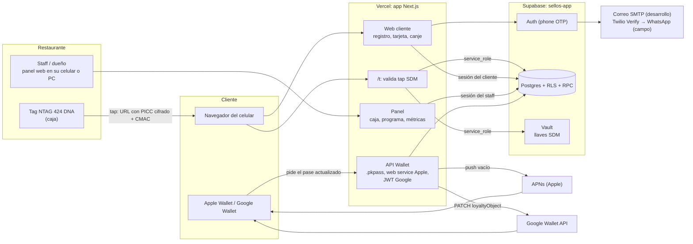
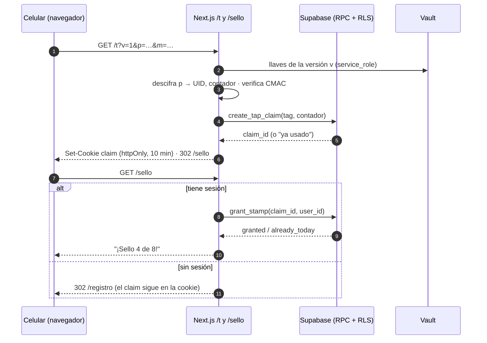

# Chugi: Plan de arquitectura del piloto (Fase 1)

**Estado:** borrador para aprobación · **Fecha:** 2026-10-28 · **Autor:** Raúl Verduzco (con Claude Code)

**Base:** [`BRIEF.md`](./BRIEF.md) (producto) y [`configuracion-base-datos.md`](./configuracion-base-datos.md) (esquema ya aplicado en `sellos-app`). Este plan **reemplaza** la sección 13 "Próximas fases" de ese documento, que asumía una app nativa.

**Decisiones tomadas en esta fase:**

| Tema | Decisión |
| --- | --- |
| Web, panel y backend | Una sola app **Next.js en Vercel** |
| Base de datos y autenticación | Proyecto de Supabase existente `sellos-app` |
| Código de registro | **Desarrollo: código por correo** (Supabase Auth email OTP). **Antes de las pruebas de campo: WhatsApp vía Twilio Verify.** |
| Dominio de desarrollo | **`chugi.rulasvrdz.com`** (DNS en Cloudflare). El dominio de producción sigue abierto (9.2). |
| Responsable ante la LFPDPPP | **Chugi** (hoy, Raúl Verduzco como persona física) |
| Cuentas de Apple y Google Wallet | A nombre de **persona física (Raúl)** |
| Sellos NFC | **1 o 2 NTAG 424 DNA dentro de un sello impreso en 3D en la caja**, a la vista del staff (por comprar) |
| Respaldo sin NFC | **QR rotativo** que la caja muestra a solicitud desde el panel |
| Cuenta de caja | **Una cuenta compartida** con rol `staff`. El dueño o gerente tiene su propia cuenta. |
| Programa (N, premio, vigencia) | **Configurable desde el panel** del negocio |
| Planes | **Free** (Vercel Hobby + Supabase Free) hasta que Raúl indique el cambio a Pro |
| Inactividad | Borrado de cuentas tras **12 meses sin visitas, con notificación previa** |
| Zona horaria del "día" | `America/Mexico_City`, guardada por negocio |
| Validación del canje | La caja teclea un código de 6 dígitos en el panel web (sin app de staff) |

---

## 1. Resumen de la arquitectura

El cliente nunca instala nada. El tag NFC de la caja abre una URL firmada y de un solo uso. El servidor de Next.js la valida contra Supabase y otorga el sello. La tarjeta vive en Apple o Google Wallet y se actualiza desde el servidor.

Hay un solo despliegue de aplicación (Vercel) y una sola base de datos (Supabase). No hay colas, workers ni microservicios. El trabajo posterior a la respuesta (actualizar Wallet) corre con `after()` de Next.js, dentro de la misma petición.



---

## 2. Stack propuesto

| Pieza | Elección | Por qué |
| --- | --- | --- |
| Framework | **Next.js (App Router) + TypeScript strict** | Una sola app para la web del cliente, el panel y las rutas de API. Los Server Components y los Route Handlers dejan la lógica sensible en el servidor. |
| Hosting | **Vercel** | Se despliega desde Git con previews por PR, y Node.js completo en las funciones (necesario para firmar `.pkpass` y hablar con APNs por HTTP/2). Región `iad1`, junto a Supabase `us-east-1`. |
| Base de datos y Auth | **Supabase `sellos-app` (existente)** | Ya tiene esquema, RLS, RPC y pruebas. Auth trae phone OTP con Twilio Verify integrado. |
| Cliente Supabase | **`@supabase/ssr`** | Sesión en cookies `httpOnly` puestas por el servidor, para que la sesión sobreviva entre taps sin depender de `localStorage`. |
| Llaves de los tags | **Supabase Vault** (ya decidido) | La llave nunca vive en el repo ni en `nfc_tags`. Solo `service_role` la lee, por una RPC. |
| Código de registro (desarrollo) | **Supabase Auth email OTP + SMTP de Resend** (plan gratis: 3,000 correos al mes, dominio `rulasvrdz.com` verificado en Cloudflare) | Cuesta $0 y no depende de trámites. Se usa SMTP propio porque el de Supabase solo envía a miembros del equipo y con un límite de pocos correos por hora. |
| Código de registro (campo) | **Twilio Verify, canal WhatsApp** | Twilio genera y valida el código, y Verify cobra solo las verificaciones exitosas. Si WhatsApp falla, cambiar a SMS es un cambio de configuración (`channel`). |
| Anti-bots en el registro | **Cloudflare Turnstile** (CAPTCHA invisible, gratis) | Supabase lo valida del lado del servidor en el endpoint de OTP. Evita que bots gasten mensajes. |
| Apple Wallet | **`passkit-generator`** (Node) + web service propio | Es la librería estándar para firmar `.pkpass`. Las actualizaciones se piden con un push vacío por APNs. |
| Google Wallet | **API REST de Google Wallet** + `google-auth-library` | Botón "Guardar en Google Wallet" con un JWT firmado. Para actualizar se hace PATCH del `loyaltyObject`. |
| UI | **Tailwind CSS** | Rápido, sin librería de componentes pesada. Hay pocas pantallas. |
| Validación | **Zod** | Valida toda entrada externa (parámetros SDM, formularios, webhooks de Apple). |
| Pruebas | **Vitest** (unidad), **pgTAP** vía `supabase test db` (RLS y RPC), **Playwright** (humo e2e) | Las reglas críticas (1 sello por día, anti-replay, aislamiento RLS) se prueban en la base, que es donde se aplican. |
| Migraciones | **Supabase CLI** (`supabase/migrations`) | El esquema queda versionado en el repo. Hoy solo existe en la base. |
| Paquetes | **pnpm** | Rápido y con lockfile estricto. |
| Programar tags | **Script de Python o Node + lector USB ACR1252U** | Se usa una vez por tag. No forma parte de la app. |

**Entornos (sin overengineering):**

- **Local:** `supabase start` (Docker) + `pnpm dev`, con datos sintéticos.
- **Desarrollo y preview:** un segundo proyecto **Supabase gratuito** (`sellos-app-dev`, el plan Free permite 2 proyectos activos). La rama `dev` se publica en **`chugi.rulasvrdz.com`** (dominio asignado a la rama en Vercel) y cada PR tiene su URL de preview. Ningún PR toca datos reales.
- **Producción:** `sellos-app` + Vercel production (rama `main`), con el dominio por definir.
- **DNS en Cloudflare:** registro `CNAME chugi → cname.vercel-dns.com` en modo **"DNS only"** (nube gris), para que Vercel emita el certificado y no haya doble proxy.

---

## 3. Flujos de punta a punta

### 3.1 Tap NFC sin app → validación en servidor → sello

**Qué graba el tag:** se programa una URL NDEF con SDM (Secure Dynamic Messaging) de esta forma:

```
https://<dominio>/t?v=1&p=<PICCData cifrado, 32 hex>&m=<CMAC, 16 hex>
```

- `p` lleva el **UID del chip y el contador de lecturas**, cifrados con AES-128 con la llave de metadatos `K_meta`. El UID no viaja en claro.
- `m` es un **CMAC** calculado con la llave de archivo `K_file`, que se **diversifica por UID** a partir de una llave maestra. Copiar un tag no sirve sin su llave.
- `v` es la versión de las llaves (corresponde a `nfc_tags.key_ref`) y permite rotarlas.
- Cada lectura incrementa el contador dentro del chip, así que **cada tap genera una URL distinta**.

**Pasos:**

1. El cliente acerca el celular al tag. iPhone XS o posterior, y Android con NFC encendido, abren la URL en el navegador sin ninguna app.
2. El Route Handler `GET /t` (servidor, sin caché):
   1. Valida el formato con Zod.
   2. Obtiene `K_meta` de la versión `v` desde Vault, mediante una RPC que solo puede ejecutar `service_role`, y descifra `p` para obtener el UID y el contador.
   3. Busca el tag por `uid` en `nfc_tags` (`service_role`) y verifica que `status = 'active'`.
   4. Deriva `K_file` para ese UID y **verifica el CMAC**. Si no coincide, rechaza.
   5. Llama a la RPC `create_tap_claim(tag_id, counter)`, que en una sola sentencia hace `UPDATE nfc_tags SET last_counter = counter WHERE id = … AND last_counter < counter` e inserta un **`tap_claim`** de un solo uso con 10 min de vida. Si el contador no es mayor, la URL ya se usó: rechaza con "Acerca tu celular al sello otra vez".
   6. Guarda el `claim_id` en una **cookie `httpOnly`, `Secure`, `SameSite=Lax`, de 10 min** y redirige a `/sello`. La redirección elimina `p` y `m` de la URL visible.
3. `/sello` (servidor) revisa la sesión del cliente con `supabase.auth.getUser()`:
   - **Con sesión:** llama a la RPC `grant_stamp(claim_id, user_id)` con `service_role`. Muestra "¡Sello 4 de 8!" y, si aplica, "Ya ganaste tu premio".
   - **Sin sesión:** manda al flujo de registro (3.2). El claim espera en la cookie.
4. `grant_stamp` (una transacción, `SECURITY DEFINER`, ejecutable **solo** por `service_role`):
   1. Bloquea el claim (`FOR UPDATE`) y verifica que no esté consumido ni vencido.
   2. Crea el `enrollment` si no existe (`ON CONFLICT DO NOTHING`).
   3. Busca el programa activo del negocio.
   4. Inserta en `visits`. Un trigger calcula `stamp_date` en la zona horaria del negocio, y el índice único `(enrollment_id, stamp_date)` **rechaza un segundo sello el mismo día** (ver 4.3).
   5. Marca el claim como consumido con su resultado (`granted`, `already_today` o `expired`) y devuelve el conteo de sellos vigentes.
5. Con `after()`, el servidor actualiza los pases de Wallet de ese enrollment (3.3) sin hacer esperar al cliente.



### 3.2 Registro con celular + código

Objetivo: **menos de 30 s en caja**. Solo hay un registro por cliente y por plataforma, no por negocio.

**Dos fases de canal, mismo flujo:**

| Fase | Identificador | Envío del código | Quién se registra |
| --- | --- | --- | --- |
| **Desarrollo** (rebanadas 1 a 6) | Correo | Supabase Auth email OTP (plantilla con `{{ .Token }}`, código de 6 dígitos, no magic link) vía SMTP de Resend | Solo el equipo y testers con cuentas de prueba |
| **Campo** (story "Cambio a WhatsApp", antes de las pruebas con clientes) | Celular +52 | Supabase Auth phone OTP con Twilio Verify, `channel: 'whatsapp'` | Clientes reales |

El cambio está aislado en **un solo módulo** (`src/lib/auth/otp.ts`) y en la variable `AUTH_OTP_CHANNEL=email|whatsapp`. Cambian la llamada (`signInWithOtp({ email })` contra `signInWithOtp({ phone, options: { channel: 'whatsapp' } })`), el `type` de `verifyOtp` y el campo del formulario. **Las cuentas de prueba por correo se borran antes de abrir el registro a clientes.** Así ningún cliente real queda con correo y se mantiene el inventario de datos de §6.

**Flujo (descrito en la fase de campo):**

1. `/registro` pide **solo** el número celular (prefijo +52 fijo), un nombre de pila **opcional** y el checkbox "Acepto el aviso de privacidad" con el aviso simplificado visible y un enlace al integral.
2. El navegador llama a `supabase.auth.signInWithOtp({ phone, options: { channel: 'whatsapp', captchaToken } })`. Turnstile es invisible.
3. Twilio Verify envía el código por WhatsApp. El cliente lo teclea en la misma pantalla (`inputmode="numeric"`, `autocomplete="one-time-code"`).
4. `verifyOtp` crea la sesión. El trigger `handle_new_user`, ya existente y ajustado, crea `profiles`. El servidor guarda `privacy_notice_version` y `privacy_accepted_at`.
5. El servidor consume el claim pendiente con `grant_stamp`, como en 3.1, y muestra el sello y los botones **"Agregar a Apple Wallet"** o **"Guardar en Google Wallet"** según el sistema operativo.
6. En visitas posteriores, la cookie de sesión de Supabase (refresh token de larga vida) permite que el tap sume directo. Si el cliente borró cookies o cambió de navegador, vuelve a pedir código.

**Por qué el claim se crea antes del registro:** el link del tag es de un solo uso. Si esperáramos a que el cliente se registre para validarlo, el contador quedaría expuesto durante el registro. Así, el tap se valida en el segundo 0 y el registro solo "cobra" un claim ya validado, ligado a la cookie de ese navegador.

**Control de costo del código.** En desarrollo (correo) el costo es $0. Aplican el límite de correos por hora de Supabase Auth, la espera de 60 s y Turnstile, y Resend corta al llegar a 100 correos al día del plan gratis. Para la fase de campo (WhatsApp), las capas se suman:

| Capa | Límite propuesto | Dónde se configura |
| --- | --- | --- |
| Envíos de OTP por hora, global del proyecto | **30/h** (tope duro de gasto: ~30 × $0.08 ≈ $2.4 USD/h en el peor caso) | Supabase → Auth → Rate Limits |
| Espera entre envíos al mismo número | **60 s** | Supabase → Auth |
| Vigencia del código | **5 min** | Supabase → Auth → Phone |
| Envíos por número | **5 por 10 min** (default de Verify) | Twilio Verify Service |
| Intentos de validación por código | **5** (default de Verify) | Twilio Verify Service |
| Países permitidos | **Solo México (+52)** | Twilio → Geo Permissions |
| Bots | **Turnstile obligatorio** en OTP | Supabase → Auth → Attack Protection |
| Alerta de gasto | **Usage Trigger a los $20 USD/mes** por correo | Twilio Console |
| UX | La pantalla de registro solo se muestra con un claim válido (tap real en los últimos 10 min) | App |

### 3.3 Tarjeta en Wallet y su actualización

**Apple Wallet (`storeCard`):**

1. "Agregar a Apple Wallet" llama a `GET /api/wallet/apple/pass`, que exige sesión. El servidor crea o reutiliza una fila en `wallet_passes` (`platform = 'apple'`, `serial_number` aleatorio), arma `pass.json` (logo del negocio, "4 / 8 sellos", premio, promo vigente, enlace "Ver mi tarjeta") y lo **firma** con el certificado del Pass Type ID. Devuelve el `.pkpass` y Safari muestra "Agregar".
2. El `authenticationToken` del pase es `HMAC-SHA256(PASS_AUTH_SECRET, serial)`, así que no se guarda ningún token: se recalcula para validar.
3. El iPhone se registra en nuestro **web service de PassKit** (`webServiceURL = https://<dominio>/api/wallet/apple`):
   - `POST /v1/devices/{device}/registrations/{passType}/{serial}` → guarda `device_library_id` + `push_token` en `apple_device_registrations`.
   - `GET /v1/devices/{device}/registrations/{passType}?passesUpdatedSince=…` → seriales con cambios.
   - `GET /v1/passes/{passType}/{serial}` → `.pkpass` regenerado.
   - `DELETE …` (el cliente quitó el pase) y `POST /v1/log`.
4. **Actualización:** tras un sello, un canje o una promo nueva, el servidor marca `wallet_passes.updated_at` y manda un **push vacío por APNs** a cada `push_token` del pase. El iPhone pide el pase nuevo solo. Si un campo cambia con `changeMessage` (por ejemplo "Nueva promo: %@"), iOS muestra la notificación en la pantalla de bloqueo.

**Google Wallet (`loyaltyClass` / `loyaltyObject`):**

1. Hay un `loyaltyClass` por negocio, creado al darlo de alta.
2. "Guardar en Google Wallet" genera un **JWT firmado** con la service account y un `loyaltyObject` (id = `issuerId.<uuid de wallet_passes>`), y lleva a `https://pay.google.com/gp/v/save/<jwt>`.
3. **Actualización:** se hace `PATCH` del `loyaltyObject` (`loyaltyPoints.balance`, mensajes). Google empuja el cambio al teléfono. No guardamos datos del dispositivo.

**Cuándo se dispara una actualización:** sello otorgado, canje solicitado o confirmado, y promo creada o vencida. Todo va en `after()`. Si falla, se registra el error (sin datos personales) y el pase se corrige en la siguiente actualización. **No hay cola.** El vencimiento de sellos por TTL se refleja en la siguiente interacción. Un cron diario de Vercel para refrescarlos queda como *Could*.

### 3.4 Canje de recompensa validado por el staff

1. En "Mi tarjeta" (`/tarjeta`), cuando el cliente tiene N sellos vigentes aparece **"Canjear premio"**. Se llama a la RPC existente `request_redemption(enrollment_id)` con la sesión del cliente. La RPC reserva los N sellos más antiguos (FIFO) y devuelve un **código de 6 dígitos** con 5 min de vida. Se muestra grande, con cuenta regresiva.
2. En la caja está abierto **`/caja`**, con la sesión de la cuenta compartida "Caja". Se teclean los 6 dígitos y se llama a la nueva RPC `confirm_redemption_by_code(business_id, code)` (ver 4.4). La RPC busca los canjes `pending` y vigentes del negocio, compara contra `code_hash` y marca `redeemed` con `redeemed_by` y `redeemed_at`.
3. La caja muestra "✅ Premio válido: *1 café gratis*" o el motivo del rechazo (vencido, ya usado, no existe). La acción se escribe en `audit_log`.
4. Con `after()`, se actualizan los pases ("0 / 8 sellos").
5. Si el código vence sin usarse, `request_redemption` ya libera la reserva en la siguiente solicitud (lógica existente).

**Por qué teclear y no escanear un QR:** 6 dígitos se teclean en menos de 5 s, no requieren permiso de cámara ni una librería de escaneo, y funcionan en cualquier celular del staff. El QR queda como mejora opcional.

**Login de la caja y del dueño:** correo + contraseña de Supabase Auth. Las cuentas las creamos nosotros (no hay autoservicio) y se ligan en `business_members` con su rol:

- **Cuenta compartida "Caja"** (rol `staff`): una por sucursal. Solo puede validar canjes, mostrar el QR de respaldo y ver la lista del día. **No** puede cambiar el programa, las promociones ni ver métricas. La sesión queda abierta en el dispositivo de caja. **La contraseña se cambia cuando sale alguien del staff.**
- **Cuenta del dueño o gerente** (rol `owner`/`manager`): personal. Configura N, premio, vigencia, promociones y ve métricas.
- **Consecuencia en la auditoría:** `redeemed_by` y `audit_log` registran "Caja", no a la persona. Con un solo restaurante se acepta. Si el dueño lo pide, más adelante se crean cuentas por persona sin cambiar el esquema.

### 3.5 Respaldo sin NFC: QR rotativo a solicitud de la caja

Es para clientes cuyo celular no tiene NFC o lo tiene apagado. **Usa el mismo camino que el tap** (claim → `grant_stamp`), así que hereda el tope de 1 sello por día y la bitácora.

1. En `/caja`, el staff toca **"Mostrar QR de sello"**. El servidor verifica la sesión y `is_member_of` y emite un **token firmado** `HMAC(QR_SECRET, business_id, location_id, jti, exp)` con **30 s de vida**. Mientras la pantalla esté abierta, el QR **se renueva cada ~20 s**, y se cierra solo a los 2 min o al registrarse un escaneo.
2. El QR codifica `https://<dominio>/q?t=<token>`. El cliente lo escanea con la cámara (sin app).
3. `GET /q` (servidor) verifica la firma y la vigencia e inserta un `tap_claim` con `source = 'qr'` y el `qr_jti` **único**. Así, el mismo QR escaneado dos veces solo funciona una vez. Después sigue igual que el tap: cookie del claim → `/sello` → registro si hace falta → `grant_stamp`.
4. **Por qué es seguro:** una foto del QR caduca en segundos y es de un solo uso. Solo se genera cuando la caja lo pide (no hay un QR fijo pegado). Cada emisión queda en `tap_claims` con su origen, así que el dueño ve en métricas cuántos sellos entraron por QR y detecta abusos.
5. El QR se dibuja en el navegador con la librería `qrcode`. No se requiere nada más.

---

## 4. Cambios al esquema existente (delta contra `configuracion-base-datos.md`)

**Paso 0, obligatorio antes de cualquier cambio:** traer el esquema actual al repo con `supabase db pull`, como migración *baseline*, y escribir pruebas pgTAP que reproduzcan las 4 pruebas RLS de la sección 10. El documento dice que el SQL está "en la sección 8", pero esa sección no contiene SQL. Hoy la base es la única fuente de verdad.

> **Hecho (CHUG-10):** el baseline vive en `supabase/migrations/20260807000000_baseline.sql` y las pruebas en `supabase/tests/`. Las diferencias con el documento (incluidos dos defectos de `request_redemption`) están en `configuracion-base-datos.md` §14.

Todas las tablas están vacías (sección 12), así que borrar columnas o recrear el enum no tiene costo de migración de datos.

### 4.1 Qué sobra del diseño para app nativa y qué se queda

| Elemento | Decisión | Razón |
| --- | --- | --- |
| `visit_status = 'pending_sync'` | **Se elimina** | No hay cola offline: el tap se valida en línea o no cuenta. |
| `visit_status = 'rejected'`, `'duplicate'` | **Se eliminan** | Los intentos fallidos no son sellos. Quedan registrados en `tap_claims.result`, no en el registro de sellos. |
| `visit_status` | **Se recrea** como `confirmed`, `voided` | `voided` permite que el gerente anule un sello dado por error sin violar el append-only (no se borra). La pantalla para anular es *Could*; el valor se crea ahora para no recrear el enum después. |
| `visits.captured_at`, `visits.synced_at` | **Se eliminan** | Sin offline, el momento del tap es el momento del servidor (`created_at`). |
| `visits.lat`, `visits.lng` | **Se eliminan** | El brief prohíbe recibir la ubicación del cliente. La presencia la prueba el tag físico, no el GPS. |
| `locations.geofence_radius_m` | **Se elimina** | No hay geofence. |
| `locations.lat`, `locations.lng` | **Se quedan** (nullable) | Son del **negocio**, no del cliente. Alimentan `locations` del pase de Apple para el aviso de cercanía (*Could*), que evalúa el teléfono sin avisarnos. |
| `profiles.phone` | **Se elimina** | Duplica `auth.users.phone`. Una sola copia del dato personal. Se ajusta `handle_new_user`. |
| `profiles.full_name` | **Se renombra** a `first_name` (nullable) | Mínimo necesario: el nombre de pila basta para personalizar el pase y la caja. |
| `nfc_tags` (`uid`, `key_ref`, `last_counter`, deny-by-default) | **Se queda igual** | Es justo lo que pide SDM. |
| `visits.sdm_counter` + `UNIQUE(tag_id, sdm_counter)` | **Se queda** | Segunda barrera anti-replay en la base. |
| `visits.expires_at`, `redemption_id`, ledger append-only | **Se queda** | Sostiene el FIFO y la auditoría. |
| `stamp_programs` (un programa activo por negocio) | **Se queda** | |
| `request_redemption` | **Se queda**, con un ajuste: el código pasa a **6 dígitos numéricos** (si hoy no lo es) | Para teclearlo en caja. |
| `confirm_redemption` | **Se queda** | La nueva RPC por código reutiliza su lógica. |
| `is_member_of`, `is_manager_of`, `audit_log`, `pgcrypto` | **Se quedan** | |

### 4.2 Cómo el link de un solo uso del NTAG 424 DNA abre la web y se valida

- **Llaves:** hay una `K_meta` por versión (por ejemplo `v1`), común a la plataforma, porque hay que descifrar `p` **antes** de saber qué tag es. También hay una `K_master_file` por versión, de la que se deriva `K_file = diversificar(K_master_file, UID)` (NXP AN10922). Las llaves maestras viven en **Vault**. `nfc_tags.key_ref` guarda la versión.
- **Nueva RPC `get_sdm_keys(p_key_ref text)`:** `SECURITY DEFINER`, ejecutable **solo** por `service_role` (`revoke … from public, anon, authenticated`). Devuelve las llaves de esa versión desde `vault.decrypted_secrets`. El cliente y el staff no pueden llamarla.
- **Validación (en `/t`, código de servidor):** descifrar con AES-128-CBC (IV cero), extraer el UID y el contador, derivar las llaves de sesión SDM y verificar el CMAC truncado. Se prueba con los **vectores oficiales de NXP AN12196** en Vitest.
- **Un solo uso, en la base:** la nueva RPC `create_tap_claim(p_tag_id, p_counter)` (solo `service_role`) hace el `UPDATE … WHERE last_counter < p_counter` atómico. Si dos peticiones llegan con la misma URL, solo una actualiza la fila. La segunda barrera es `UNIQUE(tag_id, sdm_counter)` en `tap_claims` y en `visits`.
- **Nueva tabla `tap_claims`** (RLS habilitado, **sin políticas**: solo `service_role`):

  | Columna | Tipo | Notas |
  | --- | --- | --- |
  | `id` | uuid PK | Va en la cookie `httpOnly` |
  | `source` | text not null | `nfc` \| `qr` (respaldo de 3.5) |
  | `tag_id` | uuid null FK → `nfc_tags` | Obligatorio si `source = 'nfc'` (CHECK) |
  | `business_id` | uuid FK | Denormalizado, igual que el resto del esquema |
  | `location_id` | uuid FK | |
  | `sdm_counter` | bigint null | `UNIQUE(tag_id, sdm_counter)`. Obligatorio si `source = 'nfc'`. |
  | `qr_jti` | uuid null unique | Identificador de un solo uso del QR. Obligatorio si `source = 'qr'`. |
  | `issued_by` | uuid null FK → `auth.users` | Cuenta de caja que emitió el QR |
  | `expires_at` | timestamptz | `created_at + 10 min` |
  | `consumed_at` | timestamptz null | |
  | `result` | text null | `granted` \| `already_today` \| `expired` |
  | `visit_id` | uuid null FK → `visits` | |
  | `created_at` | timestamptz | |

  Además sirve como **bitácora antifraude** para la métrica "sellos duplicados aceptados = 0". No guarda datos del cliente. `visit_id` lo liga al enrollment solo si se otorgó el sello.

### 4.3 Regla de 1 sello por cliente por día, en la base de datos

- **`businesses.timezone`** text not null default `'America/Mexico_City'`.
- **`visits.stamp_date`** date not null.
- **Trigger `BEFORE INSERT` en `visits`:** sobrescribe siempre `stamp_date := (now() AT TIME ZONE businesses.timezone)::date`, aunque quien inserta mande otro valor. Se usa un trigger porque una columna generada no acepta `AT TIME ZONE` (no es `IMMUTABLE`).
- **Índice único parcial** (ilustrativo):

  ```sql
  create unique index visits_one_per_day
    on visits (enrollment_id, stamp_date)
    where status = 'confirmed';
  ```

  Como `enrollment` = (cliente, negocio), esto es exactamente "1 sello por cliente **por negocio** por día". Si el gerente anula un sello (`voided`), el índice deja de contarlo.
- `grant_stamp` atrapa la violación del índice (`unique_violation`) y devuelve `already_today`. La interfaz solo traduce el mensaje: **la regla vive en la base**. Ni la interfaz ni una llamada directa a PostgREST pueden saltársela, porque `visits` no tiene `INSERT` para `authenticated`.
- Prueba pgTAP: dos `grant_stamp` el mismo día, con dos claims distintos, deben dar un sello y un `already_today`. Uno a las 23:59 y otro a las 00:01 hora de CDMX deben dar dos sellos.

### 4.4 Otras adiciones

| Cambio | Detalle | Acceso |
| --- | --- | --- |
| `businesses.slug` | text unique, para URLs (`/r/<slug>`) y pases | Lectura igual que `businesses` |
| `businesses.google_review_url` | text null (épica Reviews) | Igual |
| `businesses.brand_color`, `businesses.logo_path` | Branding del pase y la web (logo en Supabase Storage) | Igual |
| `profiles.privacy_notice_version`, `profiles.privacy_accepted_at` | Prueba de aceptación del aviso | El propio cliente |
| Tabla `wallet_passes` | `id`, `enrollment_id`, `platform` (`apple`\|`google`), `serial_number` unique, `google_object_id`, `created_at`, `updated_at` | RLS, sin políticas (solo `service_role`) |
| Tabla `apple_device_registrations` | `device_library_id`, `push_token`, `wallet_pass_id`, `created_at`; unique(`device_library_id`, `wallet_pass_id`) | RLS, sin políticas (solo `service_role`) |
| Tabla `promotions` | `id`, `business_id`, `title`, `body`, `starts_at`, `ends_at`, `status`, `created_at` | Cliente enrolado: SELECT de las vigentes. Manager: CRUD. Staff: SELECT. |
| RPC `grant_stamp(p_claim_id, p_user_id)` | Ver 3.1 | Solo `service_role` |
| RPC `create_tap_claim(p_tag_id, p_counter)` | Ver 4.2 | Solo `service_role` |
| RPC `create_qr_claim(p_business_id, p_location_id, p_jti, p_issued_by)` | Ver 3.5. Inserta el claim con `source = 'qr'`. El `UNIQUE(qr_jti)` garantiza un solo uso. | Solo `service_role` |
| `visits.tag_id` | Pasa a **nullable**. Los sellos por QR no tienen tag. El origen se ve en `tap_claims.source`. | — |
| Notificación de inactividad | `profiles.last_activity_at` (timestamptz) y `profiles.deletion_notice_sent_at` (timestamptz null) para el borrado a 12 meses con aviso previo (ver 6.1) | El propio cliente (lectura) |
| RPC `get_sdm_keys(p_key_ref)` | Ver 4.2 | Solo `service_role` |
| RPC `confirm_redemption_by_code(p_business_id, p_code)` | Verifica `is_member_of`. Compara contra los canjes `pending` vigentes del negocio (son pocos a la vez). Escribe en `audit_log`. | `authenticated` (la RPC verifica la membresía) |
| RPC `business_dashboard(p_business_id)` | Métricas del piloto (sección "Métricas" del brief) y lista de clientes con **teléfono enmascarado** (`•••• 1234`), nombre de pila, visitas y última visita | `authenticated` + `is_manager_of` |

**Regla para cada función nueva** (lección de la sección 11): `revoke execute … from public;` y después `grant` explícito solo al rol que corresponde. Después de cada migración se corre `get_advisors` y no se aceptan WARN nuevos.

---

## 5. Antifraude y seguridad: qué protege cada capa

| Capa | Protege contra | Mecanismo |
| --- | --- | --- |
| **Tag NTAG 424 DNA** | Clonar el sello, fotografiar un QR, fabricar URLs | AES-128 + CMAC por tap con llaves no extraíbles. Configuración bloqueada al programar. Contador interno que solo sube. |
| **Ubicación del tag (caja)** | Taps "a escondidas" o en serie | Tag dentro del sello 3D, a la vista del staff. El cliente debe estar físicamente ahí. |
| **QR rotativo (respaldo)** | Foto o reenvío del QR | Lo emite la caja a solicitud, firmado (HMAC), con 30 s de vida y un solo uso (`UNIQUE(qr_jti)`). Origen registrado en `tap_claims.source` para auditar cuántos sellos entran por QR. |
| **`/t` en servidor** | URLs copiadas o reenviadas, tags revocados | Verifica el CMAC, que el contador sea mayor que `last_counter` (atómico) y que el tag esté `active`. Elimina los parámetros de la URL. Claim de un solo uso en una cookie `httpOnly` de 10 min, ligada a ese navegador. |
| **Base: índices únicos** | Condiciones de carrera, doble sello | `UNIQUE(tag_id, sdm_counter)` y `UNIQUE(enrollment_id, stamp_date) WHERE confirmed`. `FOR UPDATE` en claims y canjes. |
| **Base: RLS y permisos** | Que un cliente o staff lea o escriba lo que no le toca | RLS en **todas** las tablas. `visits`, `nfc_tags`, `tap_claims`, `wallet_*` y `audit_log` sin escritura para `authenticated`. RPCs sensibles solo para `service_role`. `revoke from public`. |
| **Auth del cliente** | Suplantar un número, gastar mensajes | OTP por correo en desarrollo y por WhatsApp (Twilio Verify) en campo, Turnstile, límites por hora y por número, solo +52, alerta de gasto. |
| **Auth de la caja y del dueño** | Acceso al panel | Correo + contraseña creados por nosotros, rol en `business_members`. La cuenta compartida "Caja" tiene rol `staff` (sin acceso a configuración ni métricas). Contraseñas largas y únicas. Se rota la de caja cuando sale alguien del staff. La protección contra contraseñas filtradas requiere Supabase Pro: queda pendiente para cuando se cambie de plan. |
| **Canje** | Premio cobrado dos veces, código adivinado | Código hasheado de 6 dígitos con 5 min de vida, sellos reservados en transacción, validación solo por staff del negocio, `audit_log` con `redeemed_by`. |
| **Wallet** | Que un tercero pida o actualice pases ajenos | `authenticationToken` por pase (HMAC) en el web service de Apple. Generar pases exige sesión del dueño del enrollment. Las credenciales de Google y Apple solo viven en el servidor. |
| **Secretos** | Fuga de llaves | Llaves SDM en Vault. Certificado Apple, llave de Google, `SUPABASE_SERVICE_ROLE_KEY` y `PASS_AUTH_SECRET` en variables de entorno de Vercel (sensibles). Nada en el repo. Módulos con `service_role` marcados `import 'server-only'`. |

**Riesgo residual aceptado:** si alguien toca el tag y **no abre** la URL, sino que la reenvía al instante a otra persona, esa persona podría cobrar el sello sin estar presente. El tope de 1 por día, el tag a la vista del staff y la bitácora de `tap_claims` lo hacen poco rentable. Lo revisamos con datos del piloto.

---

## 6. Privacidad (LFPDPPP)

Aplica la **Ley Federal de Protección de Datos Personales en Posesión de los Particulares** vigente: la nueva ley publicada en el DOF el 20/03/2025, cuya autoridad ya no es el INAI sino la Secretaría Anticorrupción y Buen Gobierno. **El aviso debe revisarse con un abogado.** Esto es la propuesta técnica.

**Roles (decidido):** **Chugi es el responsable** de los datos de los clientes. Mientras no exista una sociedad, el responsable es **Raúl Verduzco como persona física**, con su domicilio en el aviso. El **restaurante recibe una transferencia** limitada: nombre de pila, teléfono enmascarado, visitas y canjes de sus propios clientes, para la finalidad de lealtad. Se documenta en el aviso y en el acuerdo con el restaurante, que debe incluir uso limitado a esa finalidad, confidencialidad y no extraer datos del panel.

### 6.1 Inventario de datos

| Dato | Dónde | Para qué (finalidad) | Cuánto tiempo |
| --- | --- | --- | --- |
| Número celular | `auth.users.phone` | Identificar la cuenta y enviar el código (primaria) | Mientras la cuenta esté activa. Se elimina a los **12 meses sin visitas, con aviso previo** (ver abajo), o al ejercer derechos ARCO. |
| Correo (**solo en desarrollo**) | `auth.users.email` | Iniciar sesión de cuentas de prueba del equipo y testers | Se borran **todas** antes de abrir el registro a clientes reales. Ningún cliente real da su correo. |
| Nombre de pila (opcional) | `profiles.first_name` | Personalizar la tarjeta y el saludo en caja (primaria) | Igual que la cuenta |
| Visitas (fecha y negocio) | `visits` | Otorgar sellos y premios, y métricas de recurrencia para el dueño (primaria) | Igual que la cuenta. Al eliminar la cuenta, las métricas agregadas pueden quedar anonimizadas. |
| Canjes | `redemptions`, `audit_log` | Entregar el premio y evitar fraude (primaria) | Igual que la cuenta |
| Aceptación del aviso | `profiles.privacy_*` | Demostrar el consentimiento | Igual que la cuenta |
| Identificadores de Wallet (`device_library_id`, `push_token`) | `apple_device_registrations` | Actualizar la tarjeta (primaria) | Se borran cuando el dispositivo quita el pase |
| Cookie de sesión | Navegador | Mantener la sesión entre visitas | Hasta cerrar sesión o expirar |

**No se recaba:** ubicación del cliente, correo (salvo las cuentas de prueba en desarrollo), fecha de nacimiento, datos de pago ni datos sensibles. El **staff** ve el teléfono enmascarado (últimos 4 dígitos), nunca completo.

**Borrado por inactividad con aviso previo:**

- `profiles.last_activity_at` se actualiza con cada sello o canje.
- A los **11 meses** sin actividad se notifica al cliente que su cuenta se borrará en 30 días si no regresa. El canal es primero el **pase de Wallet** (mensaje con `changeMessage` en Apple, mensaje del objeto en Google; gratis) y, si no tiene pase, una **plantilla de utilidad de WhatsApp** (centavos). Se marca `deletion_notice_sent_at`.
- A los **12 meses** se borra la cuenta con el mismo script del borrado ARCO.
- Lo ejecuta un **Vercel Cron diario** (permitido en Hobby).
- **Si el piloto dura menos de 11 meses, esto no se construye durante el piloto**, pero el aviso de privacidad ya lo declara.

**Menú (WhatsApp, *Could*):** el pedido lo abre el cliente en **su** WhatsApp hacia el número del restaurante. Chugi no guarda el pedido. El aviso informa que **el restaurante conocerá su número**.

### 6.2 Qué requiere el aviso de privacidad

1. Identidad y domicilio del responsable: Chugi, hoy Raúl Verduzco como persona física.
2. Datos que se recaban (tabla 6.1) y declaración de que no se recaban datos sensibles ni ubicación.
3. Finalidades **primarias** (lealtad, premios, tarjeta digital) y, si las hubiera, **secundarias** (por ejemplo promociones), con un mecanismo para negarse sin perder el servicio.
4. **Transferencias y remisiones:** encargados que tratan datos por nuestra cuenta, varios fuera de México: Supabase (EE. UU.), Vercel (EE. UU.), Twilio/Meta (envío del código), Apple y Google (tarjeta de Wallet). Además, la **transferencia al restaurante** (qué datos recibe y para qué).
5. **Plazo de conservación**, incluido el borrado a los 12 meses sin visitas con aviso previo.
6. Medios para ejercer **derechos ARCO** y revocar el consentimiento. Para el piloto, un correo con respuesta en los plazos legales y la eliminación hecha por nosotros con un script auditado.
7. Uso de cookies (solo de sesión, sin rastreo de terceros).
8. Cómo se comunican los cambios al aviso (versión en `profiles.privacy_notice_version`).

**Presentación:** aviso **simplificado** en la pantalla de registro, con un enlace al **integral** en `/privacidad`. Checkbox de aceptación con la versión guardada.

### 6.3 Reglas técnicas

- **Nada de datos personales en logs** de Vercel, Supabase ni Sentry (si se agrega). Se registran IDs internos (uuid), nunca el teléfono, el nombre ni el código de canje.
- Los teléfonos se enmascaran en cualquier vista del panel.
- El borrado de una cuenta es un script versionado (`scripts/`) que borra `auth.users` (en cascada) y deja rastro en `audit_log` sin datos personales.

---

## 7. Dependencias externas y trámites

Costos en USD, estimados a oct 2026. **Hay que confirmar los precios vigentes al contratar.**

| Dependencia | Trámite | Costo | Tiempo estimado | Bloquea |
| --- | --- | --- | --- | --- |
| **Apple Developer Program** (persona física) | Inscripción con Apple ID + verificación de identidad. Después, crear el Pass Type ID, el certificado de pase (sirve también para APNs) y exportar el `.p12`. | **$99/año** | 1–2 días (hasta ~1 semana si pide más verificación) | Épica Pass (Apple). **Iniciar el día 1.** |
| **Google Wallet** | Cuenta de emisor en Google Pay & Wallet Console, service account, `loyaltyClass`. "Demo mode" inmediato (solo cuentas de prueba). Para el público: **solicitar acceso de publicación** con capturas del pase. | Gratis | Demo: inmediato. Publicación: **varios días a ~2 semanas** | Salida a producción del pase de Google. **Iniciar el día 1.** |
| **Resend (SMTP de desarrollo)** | Cuenta + verificar el dominio `rulasvrdz.com` (registros SPF/DKIM en Cloudflare) + configurar el SMTP propio en Supabase Auth | Gratis (3,000 correos al mes, 100 al día) | Minutos a horas (propagación del DNS) | Registro en desarrollo (rebanada 3) |
| **Twilio (cuenta)** | Alta + upgrade de cuenta (saldo mínimo), Verify Service, Geo Permissions (solo MX), Usage Trigger | Recarga inicial ~$20 | Horas | Cambio a WhatsApp, antes de las pruebas de campo |
| **WhatsApp para Twilio Verify** | Verificación del negocio en **Meta Business Manager** + registro de un **sender de WhatsApp** en Twilio (requiere un número de teléfono propio o de Twilio) + plantilla de autenticación | Por verificación: **$0.05** (Verify, solo exitosas) + **tarifa de Meta por mensaje de autenticación a México** (centavos). Total aprox. **$0.06–0.08 por registro**. | **1–14 días** (verificación de Meta) | Pruebas de campo. **Iniciar con margen**, aunque en desarrollo se use correo: es lo que más tarda. Plan B: canal SMS (~$0.05 + tarifa SMS MX). |
| **Tags NTAG 424 DNA + sello 3D** | Compra de 5–10 tags (habrá pruebas y repuestos) + **lector USB ACR1252U** para programarlos + impresión 3D del sello de caja que aloja el tag | Tags ~$1–3 c/u · lector ~$40–60 · impresión ~$10–20 | 1–3 semanas de envío a México | Épica Stamp. **Pedir el día 1.** |
| **Dominio** | Desarrollo: subdominio **`chugi.rulasvrdz.com`** en Cloudflare (ya existe, $0). Producción: por definir. | $0 (desarrollo) | Minutos | Los tags **de prueba** se programan con el dominio de desarrollo. Los **definitivos**, con el de producción, que hay que decidir antes de programarlos. |
| **Cloudflare Turnstile** | Site key en la cuenta de Cloudflare existente | Gratis | Minutos | Registro |
| **Vercel** | **Hobby (gratis)**, decidido hasta nuevo aviso. Ojo: los términos de Hobby **no permiten uso comercial**; al cobrar el piloto o al indicarlo Raúl, se pasa a **Pro $20/mes**. | $0 | Minutos | — |
| **Supabase** | **Free (gratis)**, decidido hasta nuevo aviso: 2 proyectos (`sellos-app` + `sellos-app-dev`). Limitaciones que se mitigan: **pausa tras 7 días sin actividad** (no aplica con uso diario; en desarrollo se reactiva desde el dashboard), **sin respaldos automáticos** (respaldo manual semanal con `supabase db dump` cifrado, a cargo de Raúl, mientras haya datos reales) y **sin protección de contraseñas filtradas** (contraseñas largas y únicas para la caja y el dueño). | $0 → $25/mes (Pro, cuando se indique) | Minutos | — |
| **Placa de reseñas** (Should) | Impresión 3D + NTAG213 estático + QR impreso | ~$10–20 | Días | Épica Reviews |

**Costo mensual estimado:** en desarrollo, **$0** + Apple prorrateado (~$8/mes). En campo con planes free, **~$0.07 por cliente registrado** (WhatsApp). Al pasar a Pro: +~$45/mes.

---

## 8. Orden de construcción (rebanadas verticales)

Cada rebanada termina en algo **desplegado y usable de punta a punta**, no en una capa suelta. Las stories ya están creadas en Jira, en el proyecto `CHUG` (épicas CHUG-1 a CHUG-8, historias y tareas CHUG-9 a CHUG-45).

**Día 1, fuera de código:** iniciar los trámites de Apple y Google, pedir los tags y el lector, y empezar el aviso de privacidad. **Durante el desarrollo:** iniciar el trámite de WhatsApp (Meta) y decidir el dominio de producción, que se necesitan en la rebanada 7.

| # | Rebanada | Épica | MoSCoW | Stories propuestas | Resultado visible |
| --- | --- | --- | --- | --- | --- |
| 1 | **Esqueleto desplegado** | Fundaciones | Must | Scaffold de Next.js + Tailwind + `@supabase/ssr` + CI (lint, typecheck, test) · Migración *baseline* con `db pull` + pruebas pgTAP de la RLS existente · Proyecto `sellos-app-dev`, rama `dev` en `chugi.rulasvrdz.com` y deploys de preview · Login de la caja y del dueño (correo + contraseña) + script de alta de negocio, sucursal y cuentas | `chugi.rulasvrdz.com`: la cuenta "Caja" y la del dueño inician sesión y ven "su" negocio |
| 2 | **Primer sello real** | Stamp + Fundaciones | Must | Migración delta 1 (limpieza 4.1, `timezone`, `stamp_date` + índice, `tap_claims`, RPCs de 4.2) · Script para programar tags (SDM, diversificación, bloqueo) · Validación SDM en `/t` con vectores AN12196 · `grant_stamp` + pantalla `/sello` | Con un tag de prueba y un usuario de prueba, el tap suma un sello y el segundo del día se rechaza |
| 3 | **Registro sin fricción (correo)** | Pass | Must | OTP por correo en Supabase Auth + SMTP de Resend · Módulo `lib/auth/otp.ts` con `AUTH_OTP_CHANNEL` · Pantalla de registro + aviso simplificado + Turnstile · `/tarjeta` (mis sellos) | Un tester toca, se registra con el código del correo y ve su sello |
| 4 | **Ciclo completo: premio** | Rewards + Business + Stamp | Must | Panel: configurar N, premio y vigencia (`stamp_programs`) · Ajuste de `request_redemption` (6 dígitos) + botón "Canjear" · `/caja` + `confirm_redemption_by_code` · **QR rotativo de respaldo** en `/caja` (`/q`, `create_qr_claim`) | **Ruta crítica completa:** registro → sello (NFC o QR) → recompensa validada en caja |
| 5 | **Tarjeta en Wallet** | Pass | Must | Pase de Apple + web service + push por APNs · Pase de Google + PATCH · Disparadores con `after()` | El cliente guarda la tarjeta y la ve subir de sello en sello |
| 6 | **El dueño ve quién regresa** | Business | Must | `business_dashboard` + pantalla de métricas del piloto (incluye sellos por NFC contra QR) + lista de clientes enmascarada | El dueño ve registros, recurrencia y canjes |
| 7 | **Listo para campo** | Pass + Fundaciones | Must | **Cambio a WhatsApp** (Twilio Verify; incluye el spike de compatibilidad con Supabase Auth y los límites de costo de la tabla 3.2) · Borrado de todas las cuentas de prueba por correo · Tags definitivos programados con el dominio de producción · Aviso integral publicado + proceso ARCO · Capacitación de 10 min a la caja | Un cliente real se registra con WhatsApp en menos de 30 s |
| — | **Inicio de pruebas de campo** | — | — | Todos los Must en producción, con planes free hasta que Raúl indique el cambio | — |
| 8 | **Promociones** | Promociones + Business | Should | `promotions` + CRUD en el panel · Banner en `/tarjeta` · Promo en el pase (`changeMessage`) | El dueño publica una promo y llega a la web y al Wallet |
| 9 | **Reseñas limpias** | **Reviews** (épica nueva) | Should | `google_review_url` + redirección `/r/<slug>` con contador anónimo de aperturas · Diseño de la placa 3D (NTAG213 + QR) | Placa en mesa que abre la reseña de Google. Sin premios ni filtros. |
| 10 | **Aviso de cercanía** | Promociones | Could | `locations` + `relevantText` en el pase de Apple (Google: verificar soporte) | Recordatorio en la pantalla de bloqueo cerca del restaurante, sin que recibamos la ubicación |
| 11 | **Carta + pedido por WhatsApp** | **Menú** (épica nueva) | Could | Carta editable en el panel · Página pública de la carta · Pedido armado como link `wa.me` con el texto del pedido (sin pagos) | El restaurante publica su carta y recibe pedidos en su WhatsApp |
| 12 | **Borrado por inactividad** | Fundaciones | Could (obligatorio si la operación pasa de 11 meses) | Vercel Cron diario + aviso a 11 meses (Wallet o WhatsApp) + borrado a 12 meses | Se cumple el plazo de conservación del aviso |

**Dónde van Reviews y Menú:** propongo **dos épicas nuevas y pequeñas** ("Reviews" y "Menú") en lugar de meterlas en Business. Tienen su propio módulo en el brief, su propio riesgo (políticas de Google, privacidad del número) y prioridad distinta (Should y Could). Así no inflan las épicas de la ruta crítica. Ambas van **después** del inicio de campo, salvo que el dueño condicione la adopción a la placa de reseñas (en ese caso, la rebanada 9 sube antes de la 6).

---

## 9. Riesgos técnicos y preguntas abiertas

### 9.1 Riesgos

| Riesgo | Impacto | Mitigación |
| --- | --- | --- |
| La aprobación de WhatsApp (Meta) tarda o se rechaza | Las pruebas de campo no arrancan a tiempo | Iniciar el trámite durante el desarrollo, no al final. El plan B es SMS (mismo Twilio Verify, otro `channel`). |
| Supabase Auth + Twilio Verify con canal WhatsApp tiene limitaciones no documentadas | Rehacer la integración del OTP | **Spike en cuanto esté lista la cuenta de Twilio** (en paralelo a las rebanadas 4 a 6), para no descubrirlo en la rebanada 7. Alternativa: Send SMS Hook de Supabase + Twilio Messaging. El correo en desarrollo no depende de esto. |
| El cambio de correo a WhatsApp deja restos (cuentas de prueba, textos, pruebas e2e con correo) | Correos de prueba entre los datos reales; inventario de datos incorrecto | El canal está aislado en `lib/auth/otp.ts`. La rebanada 7 incluye el borrado de las cuentas de prueba y una verificación de que no queda ningún `auth.users.email` de clientes. |
| Celulares sin NFC, iPhone anterior al XS o Android con NFC apagado | Clientes que no pueden sellar | **QR rotativo de respaldo** desde `/caja` (3.5). Se mide la proporción NFC contra QR. |
| Abuso del QR de respaldo (la caja lo muestra sin que haya cliente presente) | Sellos regalados | QR de 30 s y un solo uso, solo a solicitud. Las métricas muestran los sellos por QR para que el dueño los revise. |
| Cuenta de caja compartida | Sin trazabilidad por persona; si se filtra la contraseña, alguien externo podría validar canjes | Rol `staff` sin configuración ni métricas, rotación de la contraseña cuando sale alguien, `audit_log`. Cuentas por persona si el dueño lo pide. |
| Se pierde la cookie de sesión (otro navegador, cookies borradas, modo privado) | Fricción y un código extra pagado | La sesión se guarda en cookies del servidor (no `localStorage`). El enlace "Ver mi tarjeta" en el pase lleva al mismo navegador. Medir cuántos re-logins hay. |
| Programar tags NTAG 424 DNA (SDM, diversificación, bloqueo) es delicado | Un tag mal programado o bloqueado se pierde | Comprar repuestos. Script probado contra vectores NXP. Un tag de práctica antes de los definitivos. |
| La URL del tag queda grabada | Cambiar de dominio obliga a reprogramar los tags | Los tags de prueba van con `chugi.rulasvrdz.com`. Los definitivos se programan **después** de fijar el dominio de producción. Ruta corta y estable (`/t`). |
| Los pases de Wallet emitidos en desarrollo apuntan a `chugi.rulasvrdz.com` | Pases de prueba que se rompen al cambiar de dominio | Solo hay pases de prueba en desarrollo. Se borran junto con las cuentas de prueba. |
| El certificado del pase de Apple vence (anual) | Los pases dejan de actualizarse | Recordatorio de renovación. La fecha queda en el README de operación. |
| Planes free durante el campo: términos de Vercel Hobby (no comercial), Supabase sin respaldos y con pausa por inactividad | Incumplir términos o perder datos reales | Decidido: free hasta que Raúl indique el cambio. Mientras tanto, respaldo manual semanal (ver 7). **Revisar los términos de Vercel antes de cobrar el piloto.** |
| Google Wallet podría no soportar avisos por ubicación | El aviso de cercanía solo funciona en iPhone | Es *Could*. Se verifica al llegar a la rebanada 10. |
| Reenvío inmediato de una URL recién tocada | Sello sin presencia | Riesgo residual aceptado (ver 5). Se monitorea con `tap_claims`. |
| La RPC existente puede diferir de lo documentado | Sorpresas al modificarla | La migración *baseline* y las pruebas pgTAP van primero (rebanada 1). |

### 9.2 Decisiones tomadas y preguntas abiertas

**Resueltas (2026-10-28):**

- Código por correo en desarrollo y por WhatsApp antes de las pruebas de campo.
- Dominio de desarrollo `chugi.rulasvrdz.com`.
- Chugi es el responsable LFPDPPP.
- Cuenta de caja compartida.
- Respaldo sin NFC con QR rotativo a solicitud.
- Programa configurable desde el panel.
- Planes free hasta nuevo aviso.
- Borrado a los 12 meses sin visitas, con aviso previo.

**Abiertas:**

1. **Dominio de producción:** ¿se queda `chugi.rulasvrdz.com` o habrá uno propio (`chugi.mx`, …)? Hay que decidirlo antes de programar los tags definitivos (rebanada 7).
2. **Duración del piloto** con el restaurante (pendiente del brief). Define si la rebanada 12 se construye durante el piloto.
3. **Acuerdo con el restaurante:** cláusulas de uso limitado y confidencialidad de los datos que recibe (revisión legal).
